# ERD Terbaru — Tabita Modiste

> Versi: 18 November 2026. Disesuaikan dengan seluruh migration yang sudah dijalankan
> (`database/migrations/2026_11_17_000001` s/d `000012`).
>
> Catatan penting: **`sales` adalah tabel induk pesanan (order master)**. Tidak dibuat
> tabel `orders` terpisah agar tidak menduplikasi konsep transaksi yang sudah ada.

## Diagram ERD

```mermaid
erDiagram
    USERS ||--o{ SALES : "memesan"
    USERS ||--o{ CUSTOMER_ADDRESSES : "memiliki"
    USERS ||--o{ CUSTOMER_NOTIFICATIONS : "menerima"
    USERS ||--o{ ORDER_STATUS_HISTORIES : "mengubah"
    USERS ||--o{ PAYMENT_PROOFS : "mengunggah/menverifikasi"

    PRODUCTS ||--o{ PRODUCT_VARIANTS : "memiliki varian"
    PRODUCTS ||--o{ SALE_ITEMS : "dijual sebagai snapshot"

    SALES ||--o{ SALE_ITEMS : "berisi"
    SALES ||--o{ PAYMENTS : "dicatat di POS"
    SALES ||--o{ PAYMENT_PROOFS : "memiliki bukti manual"
    SALES ||--o{ PAYMENT_TRANSACTIONS : "memiliki percobaan bayar"
    SALES ||--o{ SHIPMENTS : "dikirim melalui"
    SALES ||--o{ ORDER_STATUS_HISTORIES : "dicatat"
    SALES ||--o{ CUSTOMER_NOTIFICATIONS : "memiliki"
    SALES ||--o{ VOUCHER_USAGES : "memakai voucher"

    PAYMENT_METHODS ||--o{ PAYMENT_TRANSACTIONS : "dipakai"
    PAYMENT_TRANSACTIONS ||--o{ PAYMENT_WEBHOOK_LOGS : "menerima webhook"

    SHIPMENTS ||--o{ SHIPMENT_TRACKING_EVENTS : "memiliki event"
    SHIPMENTS ||--o{ SHIPMENT_LOCATIONS : "memiliki koordinat valid"

    VOUCHERS ||--o{ VOUCHER_USAGES : "dipakai"

    USERS {
        bigint id PK
        string name
        string email UK
        string role "admin|owner|customer"
        boolean is_active
    }

    SALES {
        bigint id PK
        string invoice_number UK
        bigint user_id FK
        string buyer_name
        string buyer_phone
        text buyer_address
        string status "legacy: pending_payment|completed|refunded|voided"
        string payment_status "unpaid|pending|paid|failed|expired|refunded"
        string fulfillment_status "pending|processing|packed|shipped|delivered|cancelled"
        decimal subtotal
        decimal discount_total
        decimal shipping_cost
        decimal total
        decimal paid_amount
        timestamp paid_at
        timestamp completed_at
        string idempotency_key UK
    }

    SALE_ITEMS {
        bigint id PK
        bigint sale_id FK
        bigint product_id FK "nullable"
        string product_name "snapshot historis"
        string size
        string color
        integer qty
        decimal price
        decimal cost_price
        decimal discount
        decimal total
    }

    PRODUCT_VARIANTS {
        bigint id PK
        bigint product_id FK
        string size
        string color
        unsigned_integer stock
    }

    PAYMENT_METHODS {
        bigint id PK
        string code UK "transfer|qris|gopay|ovo|dana|shopeepay|va"
        string name
        string provider "midtrans|null"
        string mode "automatic|manual"
        string logo_path
        boolean is_active
    }

    PAYMENT_TRANSACTIONS {
        bigint id PK
        bigint sale_id FK
        bigint payment_method_id FK
        string transaction_reference UK
        string provider_reference UK
        string idempotency_key UK
        decimal amount
        string status
        string qr_code_url
        timestamp expired_at
        timestamp paid_at
        json failure_detail
        json metadata
    }

    PAYMENT_WEBHOOK_LOGS {
        bigint id PK
        string provider
        string event_id UK
        string transaction_reference FK
        json sanitized_payload "tanpa secret"
        boolean signature_valid
        string processing_status
        timestamp processed_at
    }

    PAYMENT_PROOFS {
        bigint id PK
        bigint sale_id FK
        string path
        string status "pending|approved|rejected"
        bigint verified_by FK
        timestamp verified_at
        text rejection_reason
    }

    PAYMENTS {
        bigint id PK
        bigint sale_id FK
        string method "cash|qris|ewallet|transfer"
        decimal amount
        string reference
        timestamp paid_at
    }

    CUSTOMER_ADDRESSES {
        bigint id PK
        bigint user_id FK
        string label
        string recipient_name
        string phone
        text address_line
        string city
        string province
        string postal_code
        decimal latitude
        decimal longitude
        boolean is_default
    }

    VOUCHERS {
        bigint id PK
        string code UK
        string type "percent|fixed"
        decimal value
        decimal min_order
        decimal max_discount
        unsigned_integer quota
        unsigned_integer used_count
        unsigned_integer per_user_limit
        timestamp starts_at
        timestamp ends_at
        boolean is_active
    }

    VOUCHER_USAGES {
        bigint id PK
        bigint voucher_id FK
        bigint user_id FK
        bigint sale_id FK
        decimal discount_amount
    }

    SHIPMENTS {
        bigint id PK
        bigint sale_id FK
        string courier
        string service
        string tracking_number
        string biteship_order_id UK
        string biteship_tracking_id UK
        decimal shipping_cost
        string shipment_status
        string tracking_mode "scan|live"
        string live_tracking_url
        string driver_name
        string driver_plate
        datetime estimated_delivery_start
        datetime estimated_delivery_end
        decimal last_scan_latitude
        decimal last_scan_longitude
        text last_scan_location
        timestamp last_scan_at
        timestamp last_synced_at
    }

    SHIPMENT_TRACKING_EVENTS {
        bigint id PK
        bigint shipment_id FK
        string raw_status "status asli provider"
        string normalized_status
        text description
        string location
        decimal latitude
        decimal longitude
        timestamp event_time
        string source "provider|webhook|admin"
    }

    SHIPMENT_LOCATIONS {
        bigint id PK
        bigint shipment_id FK
        decimal latitude
        decimal longitude
        text location_description
        timestamp recorded_at
        string source
    }

    ORDER_STATUS_HISTORIES {
        bigint id PK
        bigint sale_id FK
        string old_payment_status
        string new_payment_status
        string old_fulfillment_status
        string new_fulfillment_status
        bigint changed_by FK
        string source "webhook|admin|system|gateway"
        text note
        timestamp created_at
    }

    CUSTOMER_NOTIFICATIONS {
        bigint id PK
        bigint user_id FK
        bigint sale_id FK
        string event_key UK
        string type
        string title
        text message
        json data
        timestamp read_at
    }
```



## Constraint & index penting

| Tabel | Constraint | Fungsi |
|---|---|---|
| `sales` | `invoice_number` UNIQUE, `idempotency_key` UNIQUE | Anti double checkout |
| `payments` | index `(sale_id, method)` | Laporan metode bayar |
| `payment_transactions` | `transaction_reference`, `provider_reference`, `idempotency_key` UNIQUE | Idempotensi gateway |
| `payment_webhook_logs` | `event_id` UNIQUE | Webhook duplikat tidak diproses ulang |
| `payment_proofs` | index `(sale_id, status)` | Antrian verifikasi Admin |
| `vouchers` | `code` UNIQUE | Kode voucher tidak dobel |
| `voucher_usages` | UNIQUE `(voucher_id, sale_id)` | Satu voucher per pesanan |
| `shipments` | `biteship_order_id`, `biteship_tracking_id` UNIQUE | Dedupe order ekspedisi |
| `shipment_tracking_events` | UNIQUE `(shipment_id, raw_status, event_time, source)` | Webhook berulang tidak menambah event |
| `customer_notifications` | `event_key` UNIQUE | Anti notifikasi berulang |
| `order_status_histories` | index `created_at` | Audit trail |

## Relasi yang sengaja tidak dibuat

- Tidak ada tabel `orders` — `sales` sudah menjadi order master.
- Tidak ada duplikat tabel pembayaran POS — `payments` tetap dipakai untuk laporan, sedangkan gateway memakai `payment_transactions`.
- `shipment_locations` hanya diisi jika provider benar-benar memberikan koordinat valid; tidak ada koordinat hasil tebakan.

## Status terpisah

```
PaymentStatus : UNPAID → PENDING → PAID / FAILED / EXPIRED / REFUNDED
FulfillmentStatus : PENDING → PROCESSING → PACKED → SHIPPED → DELIVERED / CANCELLED
ShipmentStatus : hasil mapping status mentah Biteship (inTransit, droppingOff, dll)
```

`PAID` **tidak** berarti barang terkirim. `SHIPPED` **tidak** berarti diterima.
