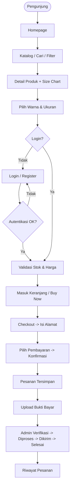
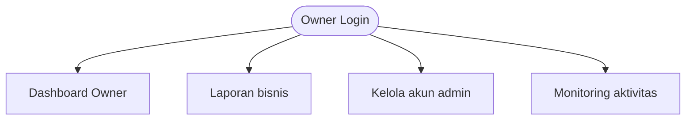

# TABITA — Rancangan UI/UX Lengkap Website E-Commerce Tabita Modiste

**Project:** Website E-Commerce Tabita Modiste
**Sumber brief:** pasted-text.txt (PRD & Master Prompt UI/UX, 11 November 2026)
**Referensi visual:** screenshot homepage fashion feminin-minimalis (attachment: image.png)
**Tanggal rancangan:** 11 November 2026
**Status:** Tahap 2 (Tahap perancangan sebelum coding bertahap). Menunggu persetujuan.

---

## 1. Executive Summary

Tabita Modiste adalah toko pakaian wanita berdiri 2010. Website e-commerce ini harus
modern, minimalis, elegan, feminin, premium-ramah — bukan situs POS yang diadaptasi.

Palet brief **ELEGANT FEMININE FASHION STORE**:

| Token | Hex | Pemakaian |
|---|---|---|
| Background utama | `#FFF9F7` | body |
| Soft pink | `#E8C3C1` | soft surfaces / aksen lembut |
| Dusty rose | `#B9787C` | aksen hover sekunder |
| Beige | `#EADBD2` | section divider |
| Teks utama | `#242020` | body text |
| Teks sekunder | `#77716F` | caption, hint |
| Tombol utama | `#BD777C` | CTA utama |
| Putih | `#FFFFFF` | kartu |

Tipografi: **Heading** serif elegan (Playfair Display / fallback Georgia); **Body** Poppins/Inter / fallback system sans.

---

## 2. Sitemap

```
/ (Home)
├── /katalog (Shop)
├── /produk/{id} (Detail: foto, size chart, varian) — butuh: ukuran & warna
├── /keranjang
├── /checkout (wajib login)
├── /wishlist (wajib login)
├── /riwayat-pesanan (wajib login)
├── /riwayat-pesanan/{order}
├── /login, /register
├── /tentang, /kontak, /panduan-ukuran
└── /admin, /owner (dashboard)
```

## 3. Komponen Inti (UI Kit)

| Komponen | Spesifikasi |
|---|---|
| `announcement-bar` | tipis 32px, teks putih di dusty rose, kiri+tengah+kanan, isi dari DB |
| `header/nav` | logo (media `logo`), menu horizontal desktop, hamburger mobile; ikon search/akun/wishlist/bag + badge |
| `hero` | banner data media `banner_home`; fallback ilustrasi SVG; 2 CTA |
| `product-card` | foto (media gallery, urutan admin), badge NEW/SALE, wishlist heart, rating bintang, harga coret bila diskon, tombol Add to Cart + Buy Now |
| `category-card` | foto kategori (media), nama, deskripsi; link ke /katalog?kategori= |
| `section-heading` | serif dengan garis sisi `.st-rule` |
| `feature-item` | ikon + judul + sub (Premium / Quality / dll.) |
| `insta-tile` | grid 6; dari media `collection` |
| `newsletter-box` | input email + consent + tombol |
| `footer` | 4 kolom + payment badge + copyright |

## 4. Per Halaman

### 4.1 Homepage (sesuai referensi)
1. Announcement bar — data dari pengaturan (DB) nantinya
2. Header + nav
3. Hero banner (media banner)
4. Service benefits (Quality / Secure Payment / Easy Shopping / Support)
5. Shop by Category (9 kategori brief: Casual, Elegant Dresses, Party Dresses, Workwear, Tops & Tees, Pants, Skirts, Outerwear, Hijab)
6. Promotional banner (Spring Collection 30% OFF, data promo)
7. Best Sellers (6, data `sold_count`)
8. Product benefits (Premium / Trendy / Customer Favorite)
9. Social gallery (media `collection`)
10. Newsletter (consent checkbox, endpoint subscribers)
11. Footer

### 4.2 Katalog
Grid responsif; sidebar filter desktop (kategori, ukuran, warna, harga min/max, stok), offcanvas/filter sheet untuk mobile; search; sorting (termurah, termahal, terbaru, terlaris); pagination.

### 4.3 Detail Produk
Dua kolom. Kiri: foto utama + thumbnail gallery (media, urutan admin). Kanan: nama, SKU
(`barcode`), harga, harga diskon, deskripsi, bahan, warna, ukuran (per varian stok), stok,
jumlah, **Size Chart** (tabel cm, per kategori), Add to Cart / Buy Now / WhatsApp.

Size chart contoh:

| Ukuran | Lebar Dada | Panjang Baju | Lebar Bahu | Panjang Lengan |
|---|---:|---:|---:|---:|
| S | 44 cm | 58 cm | 36 cm | 55 cm |
| M | 46 cm | 60 cm | 38 cm | 56 cm |
| L | 48 cm | 62 cm | 40 cm | 57 cm |
| XL | 51 cm | 64 cm | 42 cm | 58 cm |

(Data sebenarnya dari admin; kategori berbeda boleh atribut beda. Admin menambah/ubah/hapus atribut ukuran.)

### 4.4 Login + Register (desain identitas Tabita)
Login: logo, email, password, remember me, forgot password, tombol Login, link register.
Register: nama, email, **nomor WhatsApp**, password + konfirmasi, tombol Register, link login.

### 4.5 Keranjang
Per baris: foto, nama, variasi (warna/ukuran), qty, subtotal; ubah qty/hapus; ringkasan subtotal → total; nuansa dusty rose, tidak ramai.

### 4.6 Checkout (wajib login — sesuai PRD)
Alamat (nama, no WA, alamat lengkap, provinsi/kota/kecamatan/pos, catatan, metode kirim, metode bayar), ringkasan pembelian sebelum disimpan, simpan ke DB → nomor pesanan → upload bukti pembayaran → status "Menunggu Verifikasi".

### 4.7 Riwayat / Detail Pesanan
Nomor, tanggal, item, variasi, total, status pembayaran, status pengiriman, resi; buka detail kapan saja.

### 4.8 Dashboard Admin ("Admin Toko Baju")
Statistik (order masuk, menunggu pembayaran, diproses, selesai, stok menipis, omzet), grafik penjualan, produk terbaru, pesanan terbaru.

### 4.9 Dashboard Owner
Omzet, transaksi, keuntungan (dari harga pokok + aturan pengakuan penjualan), pelanggan, produk, terlaris, grafik, stok menipis.

## 5. Login Gate (UX)

Pengunjung boleh lihat: homepage, katalog, kategori, detail produk, size chart, harga, deskripsi.
Wajib login + intent tersimpan untuk: Add to Cart, Buy Now, Checkout, Wishlist, Pembayaran, Riwayat.

Alur: Add to Cart → cek auth → jika tamu → halaman login (pesan "Silakan login terlebih dahulu untuk melanjutkan pembelian di Tabita Modiste.") → pilihan Login / Register → setelah berhasil → kembali ke aksi semula → validasi ulang produk & stok → masuk keranjang.

Implementasi: middleware `auth` pada route; intended destination `session('url.intended')`; backend wajib re-check stok, harga, variasi; bukan sekadar hide button.

## 6. Workflow

### 6.1 Pengunjung → Pembeli


### 6.2 Admin
```mermaid
flowchart TD
    A([Admin Login]) --> B[Dashboard]
    B --> C[Produk / Kategori / Variasi & Stok]
    B --> D[Pesanan -> Verifikasi Pembayaran -> Update Status -> Resi]
    B --> E[Pelanggan / Laporan]
    B --> F[Tampilan Toko (media)]
```

### 6.3 Owner


## 7. Gap Analysis (apa yang sudah ada vs brief)

| Komponen / fitur | Status di codebase sekarang |
|---|---|
| Homepage elegan (hero, kategori, sale, best sellers, newsletter, footer) | ✅ Terpasang, data-driven media |
| Katalog publik + keranjang (guest) | ✅ (tanpa login gate — **bertentangan dengan PRD E.1**) |
| Checkout tamu → pesanan "Menunggu Konfirmasi" | ✅ (namun PRD mewajibkan login) |
| Detail produk + size chart | ❌ belum ada |
| Variasi ukuran & warna per produk | ❌ belum ada (brief: sangat penting) |
| Login / Register / Login gate | ⚠️ hanya ada login Admin/Owner; **tidak ada registrasi pembeli** |
| Input bukti pembayaran | ❌ belum ada |
| Riwayat pesanan pembeli | ❌ belum ada |
| Admin: manajemen pesanan | ✅ dasar (Pesanan, konfirmasi selesai) |
| Owner: laporan bisnis | ❌ placeholder |
| Dashboard admin e-commerce penuh | ⚠️ belum (masih ringkas) |
| Newsletter simpan ke DB | ❌ belum (UI saja) |
| Wishlist | ❌ belum |
| Social gallery | ✅ tile (dari media koleksi) |
| theme palet brief | ✅ sesuaikan (soft pink #E8C3C1, dusty rose #B9787C, tombol #BD777C, bg #FFF9F7, teks #242020) |

## 8. Responsive & Aksesibilitas

- Breakpoints: ≥1200, ≥992, ≥768, ≥576, <576; nav jadi hamburger di <lg; kartu produk ≤2 kolom di mobile; touch target ≥40px.
- Fokus keyboard terlihat; `aria-label` untuk tombol ikon; `alt` bermakna; kontras cukup; `prefers-reduced-motion` dihormati.

## 9. Checklist Persetujuan Desain

- [ ] Palet sesuai brief disetujui client
- [ ] Homepage sesuai referensi disetujui
- [ ] Detail produk + size chart disetujui
- [ ] Login gate (pembeli wajib daftar) disetujui
- [ ] Checkout & metode bayar (Transfer manual + upload bukti? Midtrans/Xendit?) disetujui
- [ ] Status pesanan & flow pembayaran disetujui
- [ ] Siap masuk Tahap 3 (coding bertahap)

## 10. Tahap Berikut (setelah disetujui)

- Tahap 3: layout Blade + komponen UI (selesai sebagian)
- Tahap 4: database & relasi produk (variasi, size chart)
- Tahap 5: auth + login gate (pembeli)
- Tahap 6: katalog + detail produk + size chart
- Tahap 7: keranjang + checkout (login wajib) + bukti bayar
- Tahap 8: hubungkan frontend ke DB
- Tahap 9: dashboard Admin & Owner e-commerce
- Tahap 10: testing & deploy