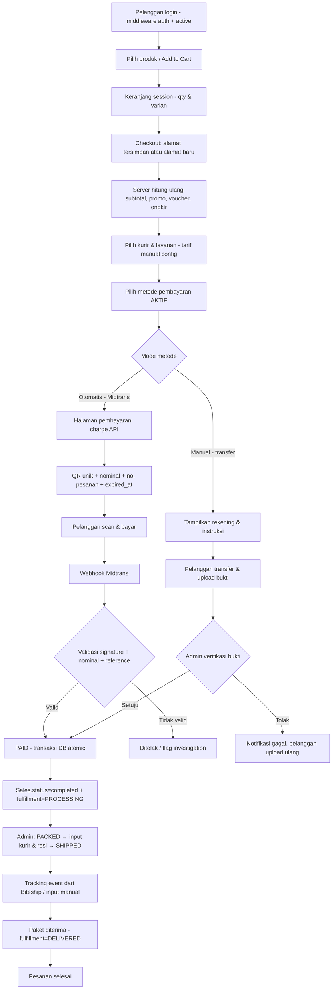
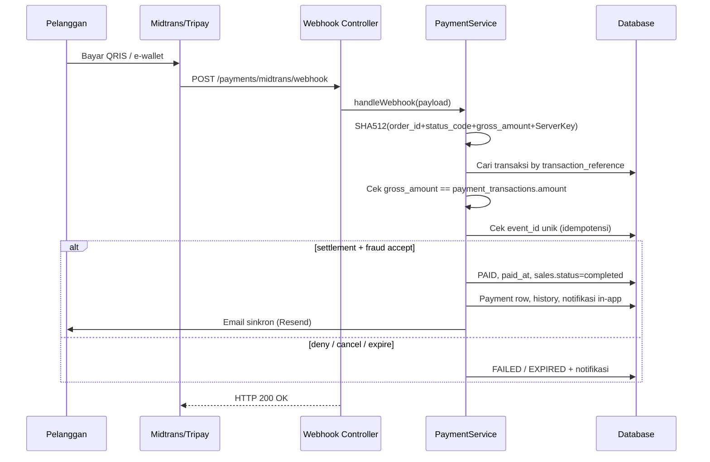
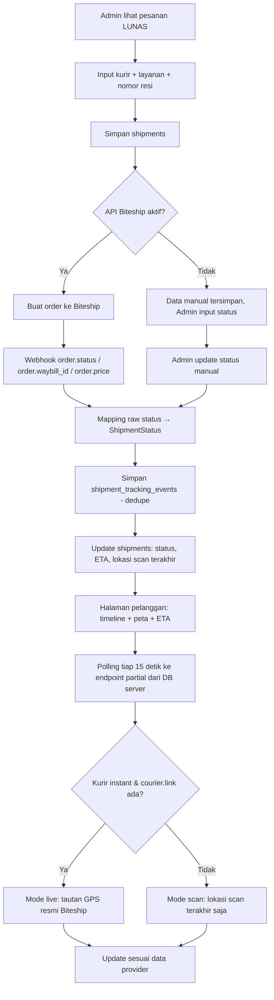

# Workflow Sistem — Tabita Modiste

> Versi: 18 November 2026. Disesuaikan dengan implementasi aktual.
> Gateway yang tertulis di sini adalah **Midtrans** (rencana diganti **Tripay** karena
> kendala pendaftaran nomor). Logika di `PaymentService` tidak berubah saat pergantian provider.

---

## 1. Workflow pembelian



### Poin penting
- Halaman checkout **hanya menampilkan metode aktif** (`payment_methods.is_active`).
- Default aktif: **transfer manual**. QRIS/e-wallet/VA otomatis aktif hanya jika `MIDTRANS_SERVER_KEY` terisi dan seeder dijalankan.
- Status awal pesanan tetap `pending_payment` (kompatibel dengan laporan lama), dengan:
  - `payment_status = UNPAID`
  - `fulfillment_status = PENDING`

---

## 2. Alur verifikasi pembayaran (webhook)



### Fallback bila webhook tidak sampai
Tombol **Cek Status Pembayaran** memanggil `PaymentService::syncFromGateway()`
→ `GET /v2/{transaction_id}/status` → diverifikasi seperti webhook.

**Status tidak pernah berubah hanya karena pelanggan kembali ke halaman website.**

---

## 3. Workflow pengiriman & tracking



### Aturan GPS
- **Reguler (JNE/J&T):** hanya titik scan. Tidak ada marker bergerak.
- **Instant (GoSend/GrabExpress):** `courier.link` dari Biteship ditampilkan sebagai tautan/iframe resmi.
- Koordinat disimpan hanya jika valid (`-90..90`, `-180..180`).
- Peta Leaflet/OpenStreetMap tampil tanpa API key; bila koordinat kosong, timeline tetap tampil & Admin bisa isi manual.

---

## 4. Transisi status

```mermaid
stateDiagram-v2
    [*] --> UNPAID
    UNPAID --> PENDING: charge gateway dibuat
    UNPAID --> PAID: webhook / verifikasi manual
    PENDING --> PAID: webhook settlement
    PENDING --> FAILED: deny/cancel
    PENDING --> EXPIRED: expire
    PAID --> REFUNDED: refund Admin

    [*] --> PENDING_FULFILLMENT
    state PENDING_FULFILLMENT as PENDING
    PENDING_FULFILLMENT --> PROCESSING: Admin terima pesanan
    PROCESSING --> PACKED: Admin kemas
    PACKED --> SHIPPED: resi diinput
    SHIPPED --> DELIVERED: scan delivered / konfirmasi
    SHIPPED --> CANCELLED: gagal/returned
```

---

## 5. Alur notifikasi

| Event | Jenis notifikasi | Pengiriman |
|---|---|---|
| Pesanan dibuat | `order_created` | in-app + email sinkron |
| Pembayaran berhasil | `payment_success` | in-app + email sinkron |
| Pembayaran gagal | `payment_failed` | in-app + email sinkron |
| Pembayaran kedaluwarsa | `payment_expired` | in-app + email sinkron |
| Status pengiriman berubah | `order_processing`, `order_packed`, `order_shipped`, `order_in_transit`, `order_out_for_delivery`, `order_delivered` | in-app + email sinkron |

Notifikasi pengiriman dibuat oleh `ShipmentNotificationService`, dipakai bersama oleh:
- `Admin\ShipmentController::updateStatus()` (input manual Admin)
- `BiteshipService::sync()` (webhook / polling API)

`event_key` unik: `{type}-shipment-{shipment_id}` → tidak ada notifikasi ganda untuk event yang sama.

Anti-duplikat: `customer_notifications.event_key` UNIQUE, mis. `payment_success-{sale_id}`.

---

## 6. Alur deploy (ringkas)

```mermaid
flowchart LR
    A[Build npm run build] --> B[Upload project ke /home/user/tabita]
    B --> C[Buat DB MySQL di cPanel]
    C --> D[Select PHP Version 8.4]
    D --> E[Document Root → /public]
    E --> F[Salin .env production]
    F --> G[composer install + migrate + storage:link + cache]
    G --> H[SSL AutoSSL]
    H --> I[Daftarkan webhook Midtrans & Biteship]
    I --> J[Uji checkout & webhook]
```



Panduan lengkap: `docs/DEPLOY-SHARED-HOSTING.md`.
